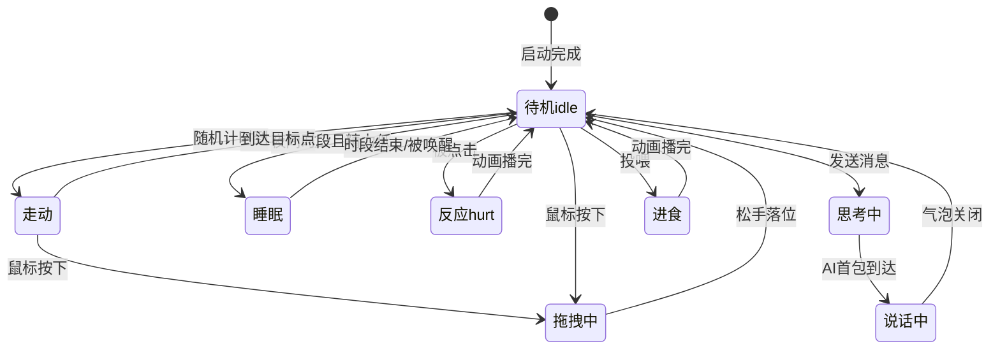
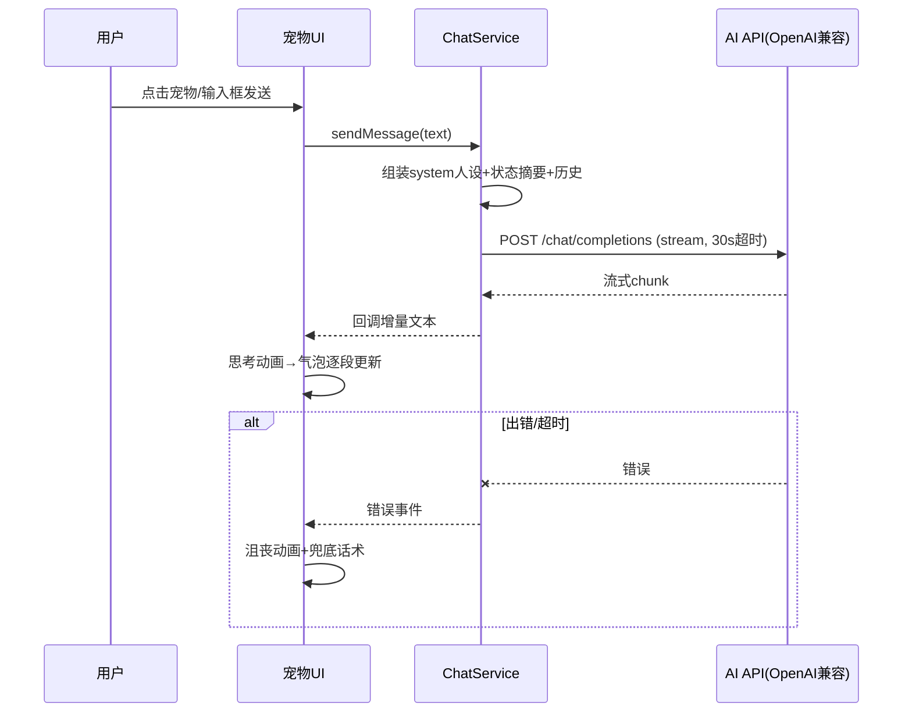
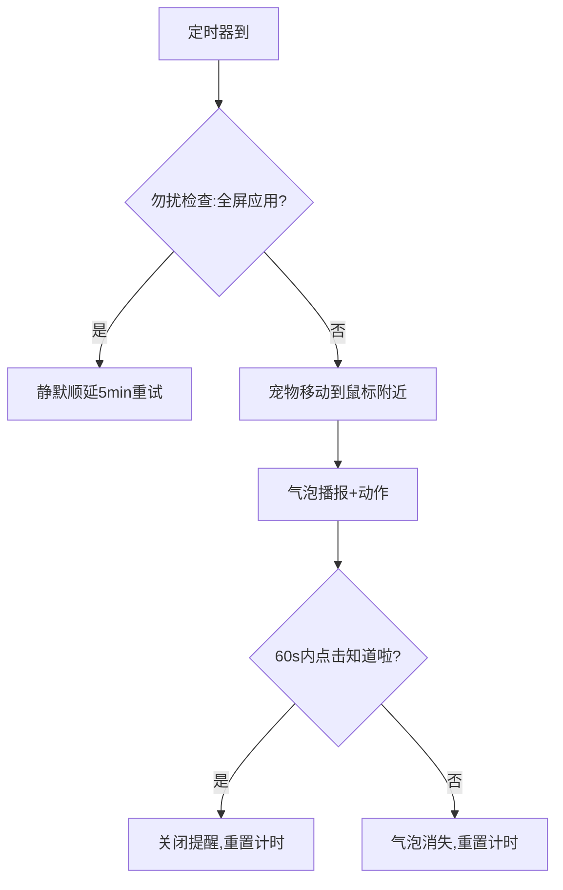

# 桌面宠物 AI Bot 需求规格说明书（PRD）

- **版本**：v1.0
- **状态**：待评审
- **技术约束**：Python + PySide6，跨平台（macOS / Windows）
- **交付形态**：源码 + 一键运行脚本（打包发布留待后续版本）

---

## A. 需求概览

### 背景
用户希望拥有一只常驻桌面的电子宠物：它趴在屏幕边缘自由活动，可以抚摸、投喂，可以用气泡和 AI 聊天，会在合适的时候提醒你喝水久坐。市售桌宠要么闭源收费、要么无 AI 能力，本项目以开源、可自定义 AI 后端的方式满足该需求。

### 核心目标
1. 一只"活着"的宠物：帧动画 + 状态机 + 自主行为，让用户愿意把它留在桌面
2. 与 AI 对话：宠物以"自己的性格"回答用户，而非冰冷的对话框
3. 陪伴价值：心情/状态系统 + 主动提醒，形成情感闭环
4. 双平台一致体验：macOS 与 Windows 行为一致

### 目标用户
- 长时间伏案的开发者 / 办公人群（主要）
- 喜欢桌宠、桌面个性化的泛用户

### 成功指标（MVP）
| 指标 | 目标 |
|------|------|
| 冷启动到宠物出现 | < 3 秒 |
| 宠物窗口内存占用 | < 300 MB |
| 聊天首字响应 | 取决于 AI 服务，本地开销 < 100ms |
| CPU 空闲占用 | < 3%（动画循环不阻塞事件） |
| 无人工干预连续运行 | > 24 小时无崩溃 |

---

## B. 用户故事

### US-1 宠物展示与动画（P0）
作为用户，我希望桌面上有一只会动的小宠物，以便它像真宠物一样有存在感和生命力。

验收标准：
- Given 应用启动成功，When 打开桌面，Then 宠物在屏幕边缘以 idle 动画待机，窗口无边框、背景透明、始终置顶
- Given 宠物处于待机，When 经过随机时间（5~15s），Then 自动切换为走动/发呆等闲置行为
- Given 用户鼠标点击宠物，When 松开，Then 播放"被戳"反应动画
- Given 帧素材缺失或损坏，When 加载失败，Then 回退为程序绘制的占位圆形形象并记录日志，不崩溃

### US-2 拖拽与走动（P0）
作为用户，我希望可以拖动宠物到屏幕任意位置，以便它适应我的桌面布局。

验收标准：
- Given 宠物在任意位置，When 按住左键拖动，Then 宠物跟随鼠标，松开后落在合法区域（不超出屏幕工作区）
- Given 多显示器环境，When 拖拽到副屏，Then 宠物可在副屏停留（Windows/macOS 均按虚拟桌面坐标处理）
- Given 宠物自主走动到达屏幕边缘，When 越界，Then 自动反向折返
- Given 用户在走动中按住宠物，When 拖拽开始，Then 立即停止自主走动行为，控制权交给用户

### US-3 AI 聊天（P0）
作为用户，我希望点击宠物后能和它对话，以便获得有性格的 AI 陪伴。

验收标准：
- Given 已配置 API Key，When 用户在聊天框输入问题并发送，Then 宠物进入"思考"动画，收到回复后以气泡逐条展示，回复期间输入框保持可用
- Given AI 服务返回流式响应，When 首包到达，Then 气泡先显示部分文本并逐步更新
- Given 未配置 API Key 或网络不可达，When 发送消息，Then 宠物以固定话术回复"我还没连上大脑哦"，错误写入日志，不弹窗阻塞
- Given 请求超过 30s 无响应，When 超时，Then 取消请求并提示超时
- Given 会话历史增长，When 超过保留上限（默认 20 轮），Then 自动截断最早历史

### US-4 状态与心情系统（P1）
作为用户，我希望宠物有饥饿、心情、精力等状态，以便通过照顾它建立情感连接。

验收标准：
- Given 应用运行中，When 时间流逝，Then 饥饿值随时间缓慢下降、精力在夜间（可配置时段）下降更快
- Given 用户通过右键菜单"投喂"，When 执行后，Then 饥饿值回升并播放进食动画
- Given 用户反复戳宠物，When 心情值下降到阈值以下，Then 宠物进入"低落"动画（长时间垂头、走动变慢）
- Given 心情/饥饿低于危险阈值，When 每隔一段冷却时间（≥30min），Then 宠物主动发起气泡求助（"我有点饿了…"）
- Given 应用退出，When 下次启动，Then 状态从本地持久化恢复并按离线时长结算衰减（衰减有下限，不会"饿死"）

### US-5 提醒陪伴（P1）
作为用户，我希望宠物在我久坐/忘喝水时提醒我，以便它提供实际的陪伴价值。

验收标准：
- Given 提醒功能开启且配置了间隔（默认喝水 45min、久坐 60min），When 间隔到达，Then 宠物移动到鼠标附近并以气泡+动作播报提醒
- Given 用户在 60s 内点击提醒气泡的"知道啦"，When 点击，Then 本轮提醒关闭
- Given 用户在 60s 内未响应，When 超时，Then 气泡自动消失且下次提醒恢复默认间隔
- Given 用户正在全屏应用（游戏中），When 触发提醒，Then 提醒静默顺延，不打扰

### US-6 设置与配置（P0）
作为用户，我希望配置 AI 服务（base_url / api_key / model / 人设 prompt），以便自由切换 OpenAI、DeepSeek、通义、Kimi 等任何 OpenAI 兼容服务。

验收标准：
- Given 首次启动未配置，When 宠物被右键选择"设置"，Then 打开设置窗口，含 AI 配置、宠物参数（走动速度、提醒开关、阈值）、人设 prompt
- Given 用户填写了配置，When 点击"测试连接"，Then 发起一次最小对话请求并反馈成功/失败原因
- Given 已保存配置，When 重启应用，Then 配置自动加载生效
- Given api_key 属于敏感信息，When 存储于本地配置文件，Then 文件权限尽量收紧（用户目录、非项目内），日志和界面回显时脱敏

---

## C. 功能模块清单

| # | 模块名 | 描述 | 优先级 | 复杂度 | 依赖 | 验收标准 |
|---|--------|------|--------|--------|------|----------|
| M1 | 宠物窗口与渲染 | 无边框透明置顶窗口、序列帧动画播放（idle/walk/hurt/think/eat/sleep/sad） | P0 | 高 | 素材包 | 启动<3s，动画不卡顿，素材缺失可降级 |
| M2 | 行为状态机 | 宠物行为（待机/走动/拖拽/反应/睡）的切换规则与自主随机行为 | P0 | 高 | M1 | 行为切换符合 US-1/US-2 验收 |
| M3 | 拖拽与移动 | 鼠标拖拽、跨屏移动、边界折返 | P0 | 中 | M1,M2 | US-2 验收标准全通过 |
| M4 | AI 聊天 | OpenAI 兼容 API 客户端（流式）、聊天窗、气泡展示、会话历史 | P0 | 高 | M1 | US-3 验收标准全通过 |
| M5 | 状态心情 | 饥饿/心情/精力数值模型、时间衰减、投喂交互、主动求助 | P1 | 中 | M2,M7 | US-4 验收标准全通过 |
| M6 | 提醒陪伴 | 喝水/久坐定时器、提醒播报、勿扰顺延 | P1 | 中 | M2,M4 | US-5 验收标准全通过 |
| M7 | 配置持久化 | JSON 配置读写、设置窗口、连接测试、脱敏 | P0 | 低 | — | US-6 验收标准全通过 |

---

## D. 边界条件与异常场景

### M1/M2/M3 宠物本体
- **Happy Path**：启动 → idle → 随机走动 → 被拖拽 → 反应动画 → 回到待机
- **边界**：屏幕分辨率变化（插拔显示器/改缩放）→ 宠物位置重新钳制到合法区域；宠物被拖到任务栏/Dock 区域 → 允许悬停于工作区边缘；走动速度极值（0~高速）不越界
- **异常**：macOS 全屏 Space 下应用不可见 → 接受（系统行为），不特殊处理；帧图尺寸不一致 → 以画布居中+缩放适配；多实例启动 → 第二实例检测并提示退出
- **业务规则**：拖拽期间禁止自主行为；思考/说话动画优先级高于闲置

### M4 AI 聊天
- **边界**：输入空消息/超长消息（>4000 字符截断）；AI 回复包含 markdown/换行 → 气泡纯文本渲染；并发发送 → 队列化，不并发打请求
- **异常**：401/403（Key 无效）、429（限流）、5xx、网络中断、超时 → 全部转化为用户可读话术 + 日志，宠物进入"沮丧"短动画；进程退出时未完成的请求取消
- **业务规则**：system prompt 包含宠物人设 + 当前心情/状态摘要，使回复与状态联动

### M5 状态心情
- **边界**：离线时长 > 7 天 → 衰减设下限；数值始终钳制在 [0,100]；系统时间被改（前跳/回拨）→ 以单调时钟+持久化时间戳双重校验，回拨不恢复数值
- **异常**：配置文件损坏 → 重置为默认并备份原文件

### M6 提醒
- **边界**：间隔配置下限 5min；同时触发两类提醒 → 合并为一条气泡
- **异常**：休眠唤醒后定时器漂移 → 唤醒时重算下一触发时间

### 跨平台差异
| 关注点 | Windows | macOS |
|--------|---------|-------|
| 置顶/穿透 | Qt 原生支持 | Qt 原生支持 |
| 全屏检测（勿扰） | 前台窗口 API | NSWorkspace（Qt 层尽力检测，检测不到则不启用勿扰） |
| 开机自启 | MVP 不实现 | MVP 不实现（后续版本） |

---

## E. 业务流程图

### 主流程：宠物行为状态机

### AI 聊天时序

### 提醒流程

---

## F. 非功能性需求

| 维度 | 要求 |
|------|------|
| 性能 | 动画基于 QTimer（约 10~15 FPS），空闲 CPU < 3%；AI 请求全异步（Qt thread/qthread 或 asyncio），绝不阻塞 UI |
| 兼容 | Python ≥ 3.10；PySide6 最新稳定版；Windows 10/11、macOS 12+（Intel/Apple Silicon） |
| 可靠 | 任意网络/配置异常不崩溃，均有降级路径；异常写入日志文件 |
| 安全 | api_key 仅存本地用户目录配置，日志与 UI 脱敏，不外发第三方；仅向用户配置的 AI endpoint 发请求 |
| 资源 | 临时文件一律置于项目内 tmp 目录，用完清理（遵循根目录规约） |
| 可维护 | 需求文档版本化存 docs/FR，技术设计版本化存 docs/NFR，实现思路记录于 AGENT.md |
| 可扩展 | 素材包、AI 后端、行为类型均可插拔扩展，为后续打包分发（PyInstaller）预留结构 |

---

## 范围外（Out of Scope for MVP）
- 可执行文件打包（PyInstaller）、代码签名、自动更新
- 开机自启、多宠物、宠物商店/皮肤市场
- 语音输入输出、TTS
- Linux 支持
